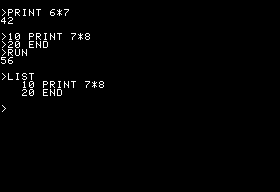
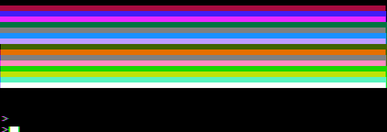
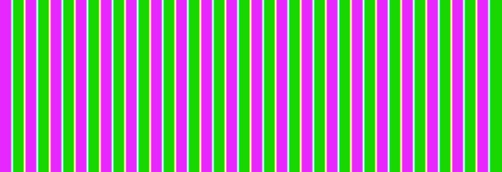

# Foundation verification

Verified locally on 4 November 2026, macOS arm64, Rust 1.99.1. This records the
first foundation's evidence; it is not a family-wide compatibility matrix.

## Observed outcome

The original non-Autostart ROM reaches the Monitor's `*` prompt after RESET.
Ctrl-B and Return enter Integer BASIC. Keyboard input through the emulated
latch produces these results, with no entry-point traps or memory injection:

```text
>PRINT 6*7
42
>10 PRINT 7*8
>20 END
>RUN
56
>LIST
   10 PRINT 7*8
   20 END
```

The headless console also executed `CALL -936` through the ROM to clear the
screen before this capture. The [actual digital raster](evidence/integer-basic.png)
was exported by the example; its text and arithmetic were visually inspected.
The capture is monochrome and uses the external logical character patterns.



Full [firmware-test output](evidence/rom-boot.txt) and
[headless-console output](evidence/console.txt) retain the observed screens.
Firmware identities and source slices are in [hardware.md](hardware.md) and
[fixtures.json](fixtures.json). The ROM SHA-256 is
`831989e3efdedd7e8dbd217f25c7101ee2d6e5aaee3de0e0f2e67b80f59fa096`.

## Checks

- `cargo fmt --all --check`.
- `cargo clippy --workspace --all-targets -- -D warnings`.
- `cargo test --workspace`: 14 fixture-free tests; the firmware test is
  explicitly ignored here, not counted as a boot pass.
- Explicit external-ROM test: 1 passed, including Monitor, BASIC arithmetic,
  stored program, RUN, LIST, a non-flat text raster and a non-halted CPU.
- `cargo llvm-cov --workspace --summary-only`: 95.60% line coverage
  (369/386 lines); the initial CI floor is 95%. This excludes the external ROM
  check and is a test-coverage measurement, not an accuracy score.
- The example was built and executed to produce the captured output above.

The scanner checks cover every visible text cell and both pages, the folded
memory map, original-II A12 during horizontal blanking, 65 CPU periods and
912 master ticks per line, 262 lines per frame, the long cycle, and video
fetches preceding CPU accesses. A RAM change after a fetch changes the next
pass, not the byte already loaded into the text shifter.

CPU-executed programs test reset-vector reads, ROM-write protection, keyboard
mirrors and strobe behaviour, and all three accesses of `INC $C03F`: read,
dummy write, final write. Audio counts are checked against elapsed crystal
time and the speaker's raw output levels.

## Checks demonstrated to fail

Each temporary mutation was applied alone, tested, and restored before the
final clean verification:

- Making speaker toggles write-only fails the read-modify-write invariant:
  `assertion \`left == right\` failed`, `left: 2`, `right: 3`.
  [Output](evidence/negative-speaker-rmw.txt).
- Removing the horizontal-state dependency in the clock network stops scanner
  progress and fails `assertion failed: line_edges.len() > 500`, before the
  scanline-period assertions. [Output](evidence/negative-long-cycle.txt).
- Requesting the ignored firmware test without its environment inputs fails
  with `set EMU198X_APPLE_II_ROM: NotPresent`, rather than silently skipping.
  [Output](evidence/negative-missing-fixtures.txt).

During test development, a program without `END` correctly printed
`*** NO END ERR`. The final workload includes `20 END`. Input pacing also
allows the ROM's own screen scrolling to finish; acknowledging a keyboard
strobe alone does not mean a command has completed.

## Remaining qualification

No running-reference differential trace, original-hardware capture, authentic
revision-0 character-mask verification, analogue flash/composite/speaker
measurement, native window/input/audio-device check, Disk II qualification is claimed. Graphics evidence is recorded below. The existing CPU's qualification is not proof of
all Apple II board behaviour. See README for the exact implemented surface.

The umbrella repo-map check accepts this repository's entry. Its full run
still exits 1 for eight unrelated unmapped workspaces/repos; running the check
against the umbrella's unchanged HEAD map, excluding this newly created repo,
reproduced the same eight problems. No unrelated workspaces were changed.

## Graphics milestone

The revision-0 machine now renders text, lo-res, hi-res and mixed mode from
live fetches on either page. The existing 280×192 monochrome API is preserved;
`colour_framebuffer()` adds a 560×192 nominal colour presentation.

The same identified original ROM executes `GR`, `COLOR=15`, `PLOT 2,2`,
`HLIN 4,8 AT 4` and `VLIN 6,10 AT 10`. The external test checks the resulting
RAM and white PICTURE output. Typed `POKE` commands select hi-res and verify
alternating dots, followed by a D7-only change that leaves the raster unchanged.
`TEXT` restores the console and `PRINT 9*9` produces `81`.
[Both firmware tests pass](evidence/graphics-rom.txt).

Two test-workload corrections came from observing the ROM:

- `GR` takes longer than the former keyboard wait. The next `C` was accepted
  after 1,947,935 master ticks **in addition to** the preceding 1,000,000-tick
  settling interval, about 206 ms in total. The console and firmware helper now
  allow one emulated second for acknowledgement, retaining a finite failure.
- Integer BASIC reports `*** >32767 ERR` for `POKE 49239,0` and the other
  unsigned I/O addresses. The workload uses signed equivalents (`-16297`,
  `-16304`, `-16302`). No optional Programmer's Aid ROM or Applesoft `HGR`
  command is assumed. The first VLIN assertion also had the wrong folded RAM
  address; row 6 of lo-res uses text row 3, address `$058A` at column 10.

The example exported these colour rasters; both were visually inspected.
The lo-res program draws all sixteen colours and retains mixed-mode text.
The hi-res workload types a small caller-owned 6502 fill routine into RAM,
executes it with BASIC's `CALL`, and selects full hi-res through `POKE`.
It fills the page with `$55`, producing violet/green strips and white joins.
This routine is test code, not firmware.





Reproduce with the existing ROM environment variables, choosing a new PPM path:

```sh
cargo run --example boot -- "$EMU198X_APPLE_II_ROM" "$EMU198X_APPLE_II_CHARS" /tmp/lores.ppm --colour < docs/evidence/lores-input.bas
cargo run --example boot -- "$EMU198X_APPLE_II_ROM" "$EMU198X_APPLE_II_CHARS" /tmp/hires.ppm --colour < docs/evidence/hires-input.bas
```

The [lo-res console](evidence/lores-console.txt), [hi-res console](evidence/hires-console.txt)
and typed input files retain the workloads. The console prints text RAM even
while graphics is selected; the exported raster is the actual display output.
Text colour fringes reflect revision 0's persistent colour burst.

Final checks cover 22 fixture-free tests and two explicit external-ROM tests,
plus format, Clippy and the example build. [Coverage](evidence/graphics-coverage.txt)
is 97.92% (564/576 lines), above the unchanged 95% floor. Coverage includes test
code and is not an accuracy measurement. New invariants cover all 7,680 visible
hi-res byte addresses on each page, all lo-res patterns and nibble halves,
D7 invariance for all 128 hi-res patterns, both modes/pages with mixed selection
at line 160, and RAM changes after a fetch appearing only on the next pass.

The square-filter fixture generator reproduces 64 window/phase cases and a
560-sample row crossing byte boundaries and right-edge blanking. Build it with
an existing C++17 compiler; it adds no build/runtime dependency:

```sh
c++ -std=c++17 -Wall -Wextra -Werror tools/reference-square-filter.cpp -o /tmp/apple-ii-reference
/tmp/apple-ii-reference /tmp/square.csv /tmp/row.csv
cmp /tmp/square.csv crates/machine-apple-ii-rev0-ntsc/tests/fixtures/mame-square-filter.csv
cmp /tmp/row.csv crates/machine-apple-ii-rev0-ntsc/tests/fixtures/mame-square-filter-row.csv
```

Removing lo-res's odd-byte phase correction demonstrably fails with
`nibble=1, y=0`; [negative-test output](evidence/negative-lores-phase.txt)
is retained. The mutation was restored before the clean checks. This is
function-level reference agreement, not a running-MAME differential trace or
an analogue display qualification. Native host integration remains a future milestone.


## Disk II

Original Monitor + Integer BASIC, the original 16-sector P5/P6 pair, and DOS
3.3 System Master (January 1, 1983) boot through slot 6. The CPU reads every
bootstrap byte and disk nibble: no ROM traps or sector injection. Exact inputs
are in [disk-fixtures.json](disk-fixtures.json) and the existing [ROM manifest](fixtures.json).

The external tests boot an authored sector, print `DISK II BOOT OK` through
Monitor COUT and observe its `$0300 = $42` marker. `tools/diagnostic-disk.py`
creates the source DSK. Convert it with Ben Zotto's
[dsk2woz2](https://github.com/bzotto/dsk2woz2/tree/97a2100285ab935f96708efb7e2c1a809c9fd441)
at that pinned revision; this diagnostic tool is not a runtime dependency.

The DOS test checks the boot banner, `CATALOG`/`HELLO`, protected SAVE with zero
writes, and a writable SAVE. It exports the memory copy, parses its checksum,
boots a fresh machine and runs `LOAD DISKTEST` / `RUN`; output is `42`.
[External test output](evidence/disk-external-tests.txt),
[archive console](evidence/disk-archive-console.txt),
[work console](evidence/disk-work-console.txt) and
[fresh exported-disk console](evidence/disk-remount-console.txt) retain the results.
The original image remains byte-identical. The example also uses `create_new`
when exporting, so an existing path cannot be overwritten.

Set absolute paths in `EMU198X_APPLE_II_ROM`, `EMU198X_APPLE_II_CHARS`,
`EMU198X_DISK_II_P5`, `EMU198X_DISK_II_P6`, `EMU198X_APPLE_II_DOS` and
`EMU198X_APPLE_II_DIAGNOSTIC`, then run:

```sh
cargo test --release --test disk_boot -- --ignored --nocapture
```

The peripheral independently executes 1,024 MAME PROM update steps, covering
read, write, data loading and protection inputs. Set `EMU198X_DISK_II_P6` and
run its ignored trace test; the generator, pinned reference and CSV live in
that repository. This compares functions, not a running whole-MAME machine.

A negative write test restores the faulty absolute-angle placement: only 98
of 100 adjacent transitions survive, and the regression fails. Restoring
interval normalization passes; DOS SAVE and fresh-machine LOAD then succeed.
Bitstream writes normalize each transition interval independently. This keeps
ordinary DOS data but does not preserve exact angular splices or sub-cell flux.
Stepper acceleration, settling, pulse shapes, arbitrary copy protections,
13-sector firmware, other slots and other Apple II boards are unqualified.

Final registry-release checks pass: 25 fixture-free machine tests, four explicit
ROM/media tests, format, Clippy, examples and [98.18% line coverage](evidence/disk-coverage.txt)
with the 95% floor unchanged. The controller has 11 fixture-free tests, its
external P6 trace and 100% line coverage. The WOZ crate has six unit tests and
an explicit external-image round-trip check.

Disabling the host Q3 event fails the CPU-driven latch invariant (`0` instead
of `$42`); [negative clock output](evidence/negative-disk-clock.txt) is retained.
The event was restored before final verification. Coverage is a test-reach
measure, not hardware-accuracy evidence.

## Shared scripts and MCP — 4 November 2026

The new runtime and suite `emu198x-apple-ii` binary use `emu198x-shell` 0.44.2.
The family supplies hardware primitives; the standard launcher and executor
supply scripts and newline-delimited JSON-RPC stdio MCP. Neither mode has a
separate Apple II control loop.

Fixture-free family checks: fmt, Clippy with warnings denied, 33 tests and
97.68% workspace line coverage (floor 95%). Five external-fixture tests are
ignored by default. The new runtime test explicitly requested with the ROM and
glyph variables enters Integer BASIC and runs `10 PRINT 6*7` / `RUN`, checking
a standalone `42` row. Existing fixture identities above remain authoritative.

The suite's `crates/emu198x-apple-ii/tests/control.rs` exercises the actual
process. Two fixture-free tests compare script observations with MCP tool
observations for exact ticks, queries, RAM writes/reads, disassembly and steps;
they check tool registration, bounded failure in both modes, missing firmware
failure in both modes, and a PNG with a 560×192 IHDR.

Both explicit external process tests passed:

- `original_basic_runs_through_scripts_and_live_mcp`: identical observations
  from Monitor boot, Ctrl-B/Return, `10 PRINT 6*7` and `RUN`; standalone `42`.
- `dos_work_disk_exports_then_reloads_in_a_fresh_mcp_process`: script-mounted
  writable DOS System Master copy, `C600G`, DOS VERSION 3.3 wait, motor-off wait,
  `10 PRINT 6*7`, `20 END`, `SAVE DISKTEST`, positive disk write count and WOZ
  export. Fresh MCP process mounts that export read-only, boots, loads and runs
  DISKTEST and prints standalone `42`. SAVE reports WRITE PROTECTED with both
  bit-write counters zero. Original archive bytes remain identical. A second
  export to an existing destination fails and preserves all destination bytes.

Reproduce in the suite repository with these absolute fixture environment paths:

```sh
export EMU198X_APPLE_II_ROM="$PWD/../roms/apple-ii/original-e000.rom"
export EMU198X_APPLE_II_CHARS="$PWD/../roms/apple-ii/characters-64.bin"
export EMU198X_DISK_II_P5="$PWD/../roms/apple-ii/disk-ii-p5-original.bin"
export EMU198X_DISK_II_P6="$PWD/../roms/apple-ii/disk-ii-p6.bin"
export EMU198X_APPLE_II_DOS="$PWD/../roms/apple-ii/DOS 3.3 System Master.woz"
cargo test -p emu198x-apple-ii -- --ignored
```

The family runtime's external test uses the first two variables and runs with
`cargo test -p emu198x-runtime-apple-ii original_rom -- --ignored`.
These tests fail if requested without fixtures. Temporary process fixtures and
exports are removed by their test guards. No proprietary bytes are committed.
Snapshot/restore remain explicit unsupported operations; later boards,
cassette and protected-flux qualification are still future work.

## Shared native window (2026-11-04)

The suite's `emu198x-apple-ii` now uses the existing `emu198x-ui` launcher and
host. Runtime 0.1.1 states NTSC composite output at the existing 14M serializer
clock, using the shell's raster-derived geometry. There is no new event loop,
audio backend or machine clock. UI is the default feature; headless builds use
`--no-default-features` and keep the same script/MCP executor.

With the original ROM, normalized glyphs, original P5/P6 and DOS WOZ identified
above, the macOS native window was exercised through UI automation:

- At Monitor, `E000G` / Return entered Integer BASIC. `PRINT 6*7` displayed `42`.
- Separate commands `GR`, `COLOR=1`, `HLIN 0,39 AT 10` displayed a magenta line
  with the lower four text rows. A colon-joined direct command gave the ROM's
  `*** SYNTAX ERR`; separate commands succeeded.
- The existing graphics-test POKEs (`8192,85`, `8193,42`, `-16297,0`,
  `-16304,0`, `-16302,0`) displayed the hi-res pattern. `TEXT` restored text.
- Machine-menu Pause added `Paused` to the title; resuming removed it. Reset
  returned to Monitor while retaining the RAM display contents.
- `C600G` / Return booted the startup WOZ and displayed `DOS VERSION 3.3
  SYSTEM MASTER`. `PRINT "NATIVE UI"` then displayed `NATIVE UI`.

The host-layout character path was exercised with `*`, quotes, commas, equals
and negative numbers. A person verified physical left Option+B followed by
Return enters Integer BASIC; `PRINT 6*7` visibly produced `42`. Temporary input
tracing confirmed actual `AltLeft` down/up and `KeyB` events. The earlier UI
automation attempt supplied aggregate ALT without physical Alt events, so it
cannot substitute for this hands-on check. All input tracing was removed.

The uncleared startup screen was confusing in the hands-on check. Repeated
inverse glyphs occupied the untouched display RAM, while BASIC input and `42`
were visible below them. Typing `CALL -936` at the BASIC prompt invoked the
ROM's screen-clear routine and left a clean `>` prompt. Coloured edges remain
in this revision-0 nominal composite presentation: the board does not suppress
text colour burst. See [hardware.md](hardware.md#graphics-signal-and-presentation)
for the reference and the decoder's limits. This is not a measurement of a
physical television's text appearance.

Authored-firmware adapter tests check encoded keyboard latch bytes, video
dimensions/bytes, varying 48 kHz mono audio packets, crystal-derived pacing
and nonzero RAM/time retention across reset. All five pass; the two existing
fixture-free process tests pass with UI enabled and disabled. All 42 shared UI
unit tests pass, as do both external-ROM script/MCP tests. The first external
invocation used relative fixture paths and failed with `No such file or
directory`; the absolute-path invocation above passes. Formatting and Clippy
pass for both feature configurations. Family tests and CI pass, including the
95% coverage gate, for the runtime metadata release.

The sandboxed launch reported `OSStatus: 560947818` opening the default audio
device. The desktop-access launch opened it without that warning. Packet
delivery and device opening are verified separately; smooth audible playback
is not established. The follow-up below records the reported crackling. Save
states remain unsupported, including through the inherited State menu. No later-board or analogue fidelity claim follows from this check.

### Native audio follow-up

The hands-on check reported crackling sound. Temporary callback counters
confirmed queue underruns in the unoptimised debug binary: requests for 96,256
interleaved samples sometimes contained thousands of missing samples, which
were replaced with zero. Opening the output device and checking the generated
waveform did not establish smooth playback. The native launch instructions
now use an optimised release build.

Two additional adapter tests check that releasing target Ctrl restores an
ordinary `B` after firmware acknowledgement, and that an authored speaker
delay loop generates approximately 1 kHz at 48 kHz with finite bounded samples
and a sample count matching elapsed master ticks. Replacing its speaker access
with unrelated I/O makes the tone test fail with `tone is 0 Hz`; restoring the
access passes. Neither test establishes physical audibility.

The optimised release build also showed intermittent queue underruns, despite
many 96,256-sample windows with zero missing samples. For example, an idle
96,256-sample window missed 480 samples, and another missed 6,590. Debug
optimisation alone does not resolve the playback defect; the person repeated
the listening check and still reported crackling. No buffering or
hardware/filter change is included in this verification change; native audio
remained an open defect at that stage. The user subsequently approved the
small shared reserve described below.

### Shared native playback reserve

The shared shell patch 0.44.3 waits for approximately 50 ms of output audio
before starting playback, after clear/reset and after an underrun. The caller's
existing maximum caps the reserve. A normal underrun retains complete queued
frames while waiting to recover; stereo channels remain aligned. Oversized
packets are trimmed before extending storage, and a callback larger than the
whole queue can consume available frames and recover on later callbacks.

Six native queue tests cover delayed stereo delivery, output-format thresholds,
starvation/recovery, clear with unsigned PCM silence, large callbacks, and
bounded overflow. Restoring immediate consumption makes the delayed-delivery
test fail with `wait for the reserve`, `[1.0, -1.0]` instead of `[0.0, 0.0]`.
Restoring priming passes. All 306 shared-shell unit tests, shell Clippy,
formatting and generated status checks pass.

The instrumented optimised native run selected 48 kHz stereo: 4,800 interleaved
samples for the reserve and 24,000 for the existing maximum. Counters separated
startup/recovery priming from callbacks that ran short after priming. Long
sequences of callbacks had no underruns, but some underruns were still observed
with host activity. This is not a controlled before/after rate comparison or a
guarantee of uninterrupted playback through arbitrary host stalls. The finite
approximately 1 kHz Monitor workload was extended to about eight seconds for a
repeat listening check. The report from that check is pending.

[Native callback evidence](evidence/native-audio-reserve.txt) retains all
completed measurement windows and defines the counters. The task window was
stopped after the test; its temporary bundle and caches are disposable.
